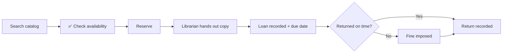

<div align="center">

# 📚 Library Management System

### *Reserve it. Borrow it. Return it. Track it.*

**Team: The Principled Four**


</div>

---

## 📖 Table of Contents

1. [Overview](#-overview)
2. [Who Uses It](#-who-uses-it)
3. [Features](#-features)
4. [Scope](#-scope)
5. [Assumptions](#-assumptions)
6. [Loan Lifecycle](#-loan-lifecycle)
7. [UML Diagrams](#-uml-diagrams)
8. [Design Risks & Patterns](#-design-risks--patterns)
9. [Repository Structure](#-repository-structure)
10. [Team](#-team)
11. [Deliverables & Timeline](#-deliverables--timeline)

---

## Overview

A Library Management System with functionality for both **students** and **librarians**, offering services and managing those services.

Students search a digital catalog, check availability, reserve books, and track their loans. Librarians hand out books, manage physical copies, and impose fines for overdue returns. Assistant librarians help at the desk using scanning to identify physical copies.

>  The **catalog is digital**, but the **books are physical**. A reservation is only a request. The librarian physically hands the book over, and that's the moment the loan starts.

---

##  Who Uses It

| Role | What they do |
|---|---|
|  **Student** | Search catalog, check availability, reserve, return, view loan statuses |
|  **Librarian** | Hand out books, create loans, manage copies, impose fines, add/edit/remove books and damaged copies |
|  **Assistant Librarian** | Help hand out and return books using scanning, view reservations |
|  **Administrator** | Manage library staff, configure system-wide settings, and oversee system integrity |

---

##  Features

### Student
- [ ] Search the digital library catalog
- [ ] Check the availability of a book
- [ ] Reserve a book for loan
- [ ] Return a book
- [ ] View loan statuses (including due dates)

### Librarian
- [ ] Hand out reserved books and create loans (system records the loan and assigns a due date)
- [ ] Track whether books have been returned
- [ ] Manage the number of physical copies per book
- [ ] View the status of individual copies and see which are loaned out
- [ ] Impose fines for overdue books
- [ ] Add new books (author, title, etc.)
- [ ] Edit book information
- [ ] Remove books, and individual physical copies if damaged

### Assistant Librarian
- [ ] Assist with handing out and returning books
- [ ] Identify physical copies by scanning
- [ ] View reservations to see which books are reserved

### Administrator
- [ ] Manage library staff (Librarians and Assistant Librarians)
- [ ] Configure system settings (fine rates, loan durations)
- [ ] Generate reports on library usage and fines


---

## Scope

### In scope
- Catalog search and availability check
- Reservations, handouts, loans, due dates, returns
- Loan status view for students
- Fines for overdue books
- Book and physical copy management (add / edit / remove)
- Scan-based identification of copies
- Reservation overview for staff

### Out of scope
> *TBD by the team. Suggestions to confirm or cut:*
- Online payment of fines
- E-books / digital lending
- Email / SMS notifications
- Multiple library branches
- Recommendations
- Detailed authentication / SSO

---

## Assumptions

1. _TBD_
2. _TBD_
3. _TBD_

---

##  Loan Lifecycle



---

##  UML Diagrams

>  **Work in progress.** Source files live in [`/docs/uml/`](docs/uml/) so commit history shows who did what.

### Class Diagram

<!-- Replace with:  -->

```
┌──────────────────────────────────────────┐
│                                          │
│        📐 CLASS DIAGRAM — COMING SOON     │
│                                          │
└──────────────────────────────────────────┘
```

| File | Owner | Status |
|---|---|---|
| `docs/uml/class-diagram.puml` | _TBD_ |  Not started |

### Sequence Diagrams

| # | Scenario | Diagram | Owner | Status |
|---|---|---|---|---|
| 1 | Student reserves a book | _link / image_ | _TBD_ |  |
| 2 | Librarian hands out a book (loan + due date) | _link / image_ | _TBD_ |  |
| 3 | Student returns a book (overdue → fine) | _link / image_ | _TBD_ |  |
| 4 | Assistant librarian scans a copy | _link / image_ | _TBD_ |  |
| 5 | Librarian removes a damaged copy | _link / image_ | _TBD_ |  |

<!-- Example embed:
### 1. Student Reserves a Book

-->

---

##  Design Risks & Patterns

> *Minimum 2 risks. Each one: the risk, why it's likely, the pattern that handles it, and where it shows in the class diagram.*

### Risk 1: _TBD_
| | |
|---|---|
| **Why it's likely** | _TBD_ |
| **Pattern** | _TBD_ |
| **Where it shows in the UML** | _TBD_ |
| **SOLID / GRASP link** | _TBD_ |

### Risk 2: _TBD_
| | |
|---|---|
| **Why it's likely** | _TBD_ |
| **Pattern** | _TBD_ |
| **Where it shows in the UML** | _TBD_ |
| **SOLID / GRASP link** | _TBD_ |

---

##  Repository Structure

```
📦 repo
 ┣ 📂 docs
 ┃ ┣ 📂 uml          ← PlantUML sources + exported images
 ┃ ┣ 📂 pdf          ← SWEN383_P1_ThePrincipledFour.pdf
 ┃ ┗ 📂 slides       ← 5-minute presentation
 ┣ 📂 src            ← code (if/when we implement)
 ┗ 📄 README.md
```

---

##  Team

**The Principled Four**

| Member | Role in Part 1 | GitHub |
|---|---|---|
| _Name_ | Scope + class diagram | [@username](https://github.com/) |
| _Name_ | Sequence diagrams (student side) | [@username](https://github.com/) |
| _Name_ | Sequence diagrams (staff side) + scanner | [@username](https://github.com/) |
| _Name_ | Design risks + patterns, repo, slides | [@username](https://github.com/) |


---

## Deliverables & Timeline

| Deliverable | Due | Status |
|---|---|---|
| Project description & scope | Mon 26 Oct | ⏳ |
| Class diagram | Mon 26 Oct | ⏳ |
| Sequence diagrams | Mon 26 Oct | ⏳ |
| Design risks + patterns (≥ 2) | Mon 26 Oct | ⏳ |
| PDF: `SWEN383_P1_ThePrincipledFour.pdf` | Mon 26 Oct, midnight | ⏳ |
| GitHub repo link (public) | Mon 26 Oct, midnight | ⏳ |
| 5-minute presentation | Wed 28 / Thu 29 Oct | ⏳ |

---

<div align="center">

*The Principled Four · SWEN-383*

</div>
