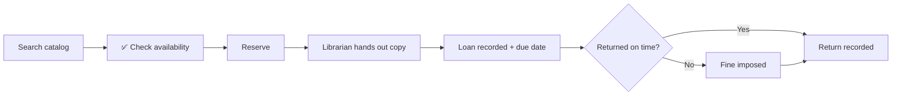

<div align="center">

# 📚 Library Management System

### *Reserve it. Borrow it. Return it. Track it.*

**Team: The Principled Four**


</div>

---

## 📖 Table of Contents

1. [Overview](#-overview)
2. [Who Uses It](#-who-uses-it)
3. [Features](#-features)
4. [Scope](#-scope)
5. [Assumptions](#-assumptions)
6. [Loan Lifecycle](#-loan-lifecycle)
7. [UML Diagrams](#-uml-diagrams)
8. [Design Risks & Patterns](#-design-risks--patterns)
9. [Repository Structure](#-repository-structure)
10. [Team](#-team)
11. [Deliverables & Timeline](#-deliverables--timeline)

---

## Overview -- Project Description

A Library Management System that gives functionality for students, librarians and assistant librarians, offering services and managing those services.

**Students** can search the digital library catalog, check the availability of a book, and place a reservation for a book title. A reservation is for a book title, not a specific copy. When a copy is free, it is put on hold for the student who reserved it, and the student gets an email. The hold expires after the hold period if the student does not pick the book up; the copy is then put on hold for the next student in line, or goes back on the shelf if no one is waiting. If all copies are out, students wait in line in the order they reserved. A student can cancel a reservation at any time before picking up the book. Students can also walk into the library and borrow any copy that is on the shelf and not on hold.

The physical book must be handed out by a librarian or assistant librarian, who scans the copy. At that moment the system records the loan and gives a due date. Students return the book at the desk, where staff scan the copy again, and the system records the return. When a copy is returned and students are waiting for that title, the system puts it on hold for the next student in line and emails them. Students can see the status of their loans, reservations and fines: a reservation is waiting in line, on hold with an expiry date, completed, expired, or cancelled; a loan is on loan with a due date, overdue, or returned.

Once a day, the system checks for overdue loans and emails the students who have them, and it releases holds that have expired. If a book is returned late, the system calculates a fine based on how many days it is overdue. A librarian can waive the fine. Fines are paid in person at the desk, where a librarian records the payment.

**Librarians** hand out physical copies and record loans: they scan the copy at the desk, and the system records the loan and assigns a due date. They manage the physical copies of each book by adding copies and marking copies as damaged, and they can see the status of every individual copy (available, on hold, on loan, or damaged). They can add new books (author, title, ISBN), edit book information, and remove books. A book cannot be removed while any of its copies is on loan or on hold, or while students are waiting for it; a removed book is marked as withdrawn and its record is kept. Damaged copies are taken off the shelf but their record is kept, so loan history stays intact. A copy that is on loan cannot be marked as damaged until it is returned.

**Assistant librarians** work at the desk: they scan copies when handing them out (the system records the loan) and when they are returned (the system records the return and calculates any fine). Librarians and assistant librarians can view reservations and holds: the queue order, each student's position, and which copy is on hold for which student.

Librarians also configure the library settings: the loan period, the hold period, and the fine rate.

> The catalog is digital, but the books are physical. A reservation is only a request. The librarian or assistant librarian physically hands the book over, and that's the moment the loan starts.

---

##  Who Uses It

| Role | What they do |
|---|---|
|  **Student** | Search catalog, check availability, reserve, cancel a reservation, return, view loan, reservation and fine statuses |
|  **Librarian** | Hand out books, create loans, manage copies, record fine payments, waive fines, add/edit/remove books, mark damaged copies, configure settings (loan period, hold period, fine rate) |
|  **Assistant Librarian** | Help hand out and return books using scanning, view reservations |

---

##  Features

### Student
- [x] Search the digital library catalog
- [x] Check the availability of a book
- [x] Reserve a book for loan
- [x] Cancel a reservation
- [x] Return a book
- [x] View loan statuses (including due dates)

### Librarian
- [x] Hand out reserved books and create loans (system records the loan and assigns a due date)
- [x] Track whether books have been returned
- [x] Manage the number of physical copies per book
- [x] View the status of individual copies and see which are loaned out
- [x] Waive fines for overdue books (the system calculates them)
- [x] Record fines paid in person at the desk
- [x] Add new books (author, title, etc.)
- [x] Edit book information
- [x] Remove books, and mark individual physical copies as damaged (taken off the shelf, record kept)
- [x] Configure library settings (loan period, hold period, fine rate)

### Assistant Librarian
- [x] Assist with handing out and returning books
- [x] Identify physical copies by scanning
- [x] View reservations to see which books are reserved

---

## Scope

### In scope
- Catalog search and availability check
- Reservations, handouts, loans, due dates, returns
- Students can cancel a reservation
- A hold is put on a reserved copy and expires after the hold period; the copy then goes on hold for the next student in line, or back on the shelf if no one is waiting
- Students can pick up copies without reserving, if it is on the shelf and not on hold
- Students wait in line in the order they reserved for books that have no available copies in the moment
- Loan, reservation and fine status view for students
- Fines for overdue books, calculated by the system; librarians can waive them
- Fines are paid in person at the desk, and a librarian records the payment in the system
- Book and physical copy management (add / edit / remove)
- A book cannot be removed while any of its copies is on loan or on hold, or while students are waiting for it; a removed book is marked as withdrawn and its record is kept
- Damaged copies are taken off the shelf and marked as damaged; their record is kept so the loan history stays intact
- Scan-based identification of copies
- Reservation overview for staff
- Email to students when a copy they reserved is available, and when a loan is overdue
- Librarians handle the configuration of library settings & policies such as loan period, hold period, and fine rate.

### Out of scope
- Online payment of fines
- E-books / digital lending
- SMS / Push notification
- Recommendations
- Multiple library branches
- Detailed authentication / SSO
- Administrator role, staff management and usage reports
- Loan renewals / extensions (a due date cannot be extended)
- Recording which staff member handled a loan or waived a fine (staff are actors, not stored in the system)

---

## Assumptions

1. Identifying the student at the desk (e.g. scanning a student card) is handled outside our design; the system receives the student who is borrowing.
2. Every book is identified by its ISBN, and every physical copy by a unique barcode.
3. Overdue loans and expired holds are checked once a day; the overdue email is sent then, and expired holds are released.

---

##  Loan Lifecycle



---

##  UML Diagrams

>  **Work in progress.** Source files live in [`/docs/uml/`](docs/uml/) so commit history shows who did what.

### Class Diagram

<!-- Replace with:  -->

Source: [`docs/uml/class-diagram.puml`](docs/uml/class-diagram.puml) (11 classes)

| Part | Classes | What they do |
|---|---|---|
| **Controller** | `LibraryController` | Receives every request from the screens (student, desk, librarian) and passes the work on to the domain classes. It coordinates; it does not do the work itself (GRASP Controller). |
| **Domain** | `Student`, `Book`, `Copy`, `Reservation`, `Loan`, `Fine`, `Catalog` | The library itself. `Catalog` holds all books, a `Book` holds its copies and its waiting line of reservations, a `Copy` is lent out in loans, and a late `Loan` creates its `Fine`. |
| **Helpers** | `LibrarySettings` | Holds the loan period, hold period and fine rate, and does the date and fine calculations, so no number is hard-coded anywhere. |
| | `EmailSender` | Sends the "your reserved copy is ready" and "your loan is overdue" emails. |
| | `ReminderScheduler` | Checks once a day for overdue loans and sends the reminders. No library concept fits this job, so it is its own class (GRASP Pure Fabrication). |

**Reading the lines**
- Solid line: one class keeps a reference to the other (association), with a multiplicity on both ends.
- Filled diamond: the whole owns the part, and the part cannot exist without it (composition), e.g. `Book` and its `Copy` objects.
- Dashed arrow: one class only uses the other for a moment, as a parameter or return value (dependency).

| File | Owner | Status |
|---|---|---|
| `docs/uml/class-diagram.puml` | Erion Elezaj | Draft done, to be reviewed by the team |

### Sequence Diagrams

Each sequence diagram starts with the actor sending a request to `:LibraryController`.

| # | Scenario | Diagram | Owner | Status |
|---|---|---|---|---|
| 1 | Librarian hands out a copy (scan → loan + due date) | _link / image_ | Erion Elezaj | Not started |
| 2 | Student reserves a book (copy free → hold + email; no copy → waiting line) | _link / image_ | Elion Elezaj | Not started |
| 3 | Student returns a book (late → fine; next student in line gets the hold) | [seq-return.puml](docs/uml/seq-return.puml) | Lorand Pervizaj | Done |
| 4 | Librarian marks a damaged copy (refused if the copy is on loan) | _link / image_ | Dren Veliu | Not started |

<!-- Example embed:
### 1. Student Reserves a Book

-->

---

##  Design Risks & Patterns

> *Minimum 2 risks. Each one: the risk, why it's likely, the pattern that handles it, and where it shows in the class diagram.*

### Risk 1: Inconsistent State during Concurrent Access
| | |
|---|---|
| **Why it's likely** | Multiple staff members might try to check out the same physical copy or modify a book's status simultaneously, leading to race conditions. |
| **Pattern** | Controller / Singleton |
| **Where it shows in the UML** | `LibraryController` acts as a single point of entry for all domain logic, ensuring operations are coordinated. |
| **SOLID / GRASP link** | GRASP Controller / Single Responsibility Principle |

### Risk 2: High Coupling between Logic and Notification
| | |
|---|---|
| **Why it's likely** | Hard-coding email notifications directly into the loan or reservation logic makes it difficult to change notification methods (e.g., adding SMS) later. |
| **Pattern** | Pure Fabrication / Dependency Injection |
| **Where it shows in the UML** | `EmailSender` and `ReminderScheduler` are separated from the core domain classes (`Loan`, `Book`). |
| **SOLID / GRASP link** | GRASP Pure Fabrication / Dependency Inversion Principle |

---

##  Repository Structure

```
📦 repo
 ┣ 📂 docs
 ┃ ┣ 📂 uml          ← PlantUML sources + exported images
 ┃ ┣ 📂 pdf          ← SWEN383_P1_ThePrincipledFour.pdf
 ┃ ┗ 📂 slides       ← 5-minute presentation
 ┣ 📂 src            ← code (if/when we implement)
 ┗ 📄 README.md
```

---

##  Team

**The Principled Four**
 Each member has their own sequence diagrams they must make, class diagram will be done by Erion as extra

| Member | Role in Part -1| GitHub |
|---|---|---|
| Erion Elezaj | Hand out a copy: librarian scans it, the system creates the loan and sets the due date (Extra: Class UML) | [@erionelezaj](https://github.com/erionelezaj) |
| Elion Elezaj | Student reserves a book: copy free → hold + email; no copy → waiting line | [@elioni2](https://github.com/elioni2) |
| Lorand Pervizaj | Student returns a book: late → fine; next student in line gets the hold | [@LorandPervizaj](https://github.com/LorandPervizaj) |
| Dren Veliu | Mark a damaged copy: refused if the copy is on loan; the copy's record is kept | [@Doreni005](https://github.com/Doreni005) |


---

## Deliverables & Timeline

| Deliverable | Due | Status | Completed |
|---|---|---|---|
| Project description & scope | Mon 26 Oct | ✅ | Mon 12 Oct |
| Class diagram | Mon 26 Oct | ✅ | Tue 06 Oct |
| Sequence diagrams | Mon 26 Oct | ⏳ | In Progress |
| Design risks + patterns (≥ 2) | Mon 26 Oct | ✅ | Wed 21 Oct |
| PDF: `SWEN383_P1_ThePrincipledFour.pdf` | Mon 26 Oct, midnight | ⏳ | Not Started |
| GitHub repo link (public) | Mon 26 Oct, midnight | ✅ | Wed 14 Oct |
| 5-minute presentation | Wed 28 / Thu 29 Oct | ⏳ | Not Started |

---

<div align="center">

*The Principled Four · SWEN-383*

</div>
