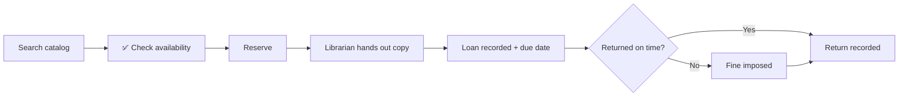

<div align="center">

# 📚 Library Management System

### *Reserve it. Borrow it. Return it. Track it.*

**Team: The Principled Four**


</div>

---

## 📖 Table of Contents

1. [Overview](#-overview)
2. [Who Uses It](#-who-uses-it)
3. [Features](#-features)
4. [Scope](#-scope)
5. [Assumptions](#-assumptions)
6. [Loan Lifecycle](#-loan-lifecycle)
7. [UML Diagrams](#-uml-diagrams)
8. [Design Risks & Patterns](#-design-risks--patterns)
9. [Repository Structure](#-repository-structure)
10. [Team](#-team)
11. [Deliverables & Timeline](#-deliverables--timeline)

---

## Overview -- Project Description

A Library Management System that gives functionality for students, librarians and assistant librarians, offering services and managing those services.

Students can search the digital library catalog, check the availability of a book, and reserve a book for a loan. A reservation is for a book title, not a specific copy. When a copy is free, it is put on hold for the student who reserved it, and the hold expires after a few days if the student does not pick it up. If all copies are out, students wait in line in the order they reserved. Students can also walk into the library and borrow any copy that is on the shelf and not on hold.

The physical book must be handed out by a librarian or assistant librarian, who scans the copy. At that moment the system records the loan and gives a due date. Students return the book at the desk, where the copy is scanned again, and the system records the return. Students can see the status of their loans and reservations.

If a book is returned late, the system calculates a fine based on how many days it is overdue. A librarian can waive the fine. Fines are paid in person at the desk, where staff record the payment.

Librarians manage handing out books and giving out loans, and manage how many physical copies of a book there are. They can see the status of individual copies and identify which ones are loaned out or on hold. They can add new books with information such as the author name and title, edit book information, and remove books from the system. Damaged physical copies are taken off the shelf and marked as damaged, but their record is kept.

Assistant librarians assist with handing out and returning books, using scanning to identify physical copies. The system displays reservations so librarians can see which books have been reserved.

Librarians also configure the library settings: the loan period, the hold period, and the fine rate.

>  The **catalog is digital**, but the **books are physical**. A reservation is only a request. The librarian physically hands the book over, and that's the moment the loan starts.

---

##  Who Uses It

| Role | What they do |
|---|---|
|  **Student** | Search catalog, check availability, reserve, cancel a reservation, return, view loan statuses |
|  **Librarian** | Hand out books, create loans, manage copies, record fine payments, waive fines, add/edit/remove books, mark damaged copies, configure settings (loan period, hold period, fine rate) |
|  **Assistant Librarian** | Help hand out and return books using scanning, view reservations |

---

##  Features

### Student
- [ ] Search the digital library catalog
- [ ] Check the availability of a book
- [ ] Reserve a book for loan
- [ ] Cancel a reservation
- [ ] Return a book
- [ ] View loan statuses (including due dates)

### Librarian
- [ ] Hand out reserved books and create loans (system records the loan and assigns a due date)
- [ ] Track whether books have been returned
- [ ] Manage the number of physical copies per book
- [ ] View the status of individual copies and see which are loaned out
- [ ] Waive fines for overdue books (the system calculates them)
- [ ] Record fines paid in person at the desk
- [ ] Add new books (author, title, etc.)
- [ ] Edit book information
- [ ] Remove books, and mark individual physical copies as damaged (taken off the shelf, record kept)
- [ ] Configure library settings (loan period, hold period, fine rate)

### Assistant Librarian
- [ ] Assist with handing out and returning books
- [ ] Identify physical copies by scanning
- [ ] View reservations to see which books are reserved

---

## Scope

### In scope
- Catalog search and availability check
- Reservations, handouts, loans, due dates, returns
- Students can cancel a reservation
- A hold is put on a reserved copy and expires in a few days
- Students can pick up copies without reserving, if it is on the shelf and not on hold
- Students wait in line in the order they reserved for books that have no available copies in the moment
- Loan status view for students
- Fines for overdue books, calculated by the system; librarians can waive them
- Fines are paid in person at the desk, and staff record the payment in the system
- Book and physical copy management (add / edit / remove)
- Damaged copies are taken off the shelf and marked as damaged; their record is kept so the loan history stays intact
- Scan-based identification of copies
- Reservation overview for staff
- Email to students when a copy they reserved is available, and when a loan is overdue
- Librarians handle the configuration of library settings & policies such as loan period, hold period, and fine rate.

### Out of scope
- Online payment of fines
- E-books / digital lending
- SMS / Push notification
- Recommendations
- Multiple library branches
- Detailed authentication / SSO
- Administrator role, staff management and usage reports
- Loan renewals / extensions (a due date cannot be extended)
- Recording which staff member handled a loan or waived a fine (staff are actors, not stored in the system)

---

## Assumptions

1. Identifying the student at the desk (e.g. scanning a student card) is handled outside our design; the system receives the student who is borrowing.
2. Every book is identified by its ISBN, and every physical copy by a unique barcode.
3. Overdue loans are checked once a day, and the overdue email is sent then.

---

##  Loan Lifecycle



---

##  UML Diagrams

>  **Work in progress.** Source files live in [`/docs/uml/`](docs/uml/) so commit history shows who did what.

### Class Diagram

<!-- Replace with:  -->

Source: [`docs/uml/class-diagram.puml`](docs/uml/class-diagram.puml) (11 classes)

| Part | Classes | What they do |
|---|---|---|
| **Controller** | `LibraryController` | Receives every request from the screens (student, desk, librarian) and passes the work on to the domain classes. It coordinates; it does not do the work itself (GRASP Controller). |
| **Domain** | `Student`, `Book`, `Copy`, `Reservation`, `Loan`, `Fine`, `Catalog` | The library itself. `Catalog` holds all books, a `Book` holds its copies and its waiting line of reservations, a `Copy` is lent out in loans, and a late `Loan` creates its `Fine`. |
| **Helpers** | `LibrarySettings` | Holds the loan period, hold period and fine rate, and does the date and fine calculations, so no number is hard-coded anywhere. |
| | `EmailSender` | Sends the "your reserved copy is ready" and "your loan is overdue" emails. |
| | `ReminderScheduler` | Checks once a day for overdue loans and sends the reminders. No library concept fits this job, so it is its own class (GRASP Pure Fabrication). |

**Reading the lines**
- Solid line: one class keeps a reference to the other (association), with a multiplicity on both ends.
- Filled diamond: the whole owns the part, and the part cannot exist without it (composition), e.g. `Book` and its `Copy` objects.
- Dashed arrow: one class only uses the other for a moment, as a parameter or return value (dependency).

| File | Owner | Status |
|---|---|---|
| `docs/uml/class-diagram.puml` | Erion Elezaj | Draft done, to be reviewed by the team |

### Sequence Diagrams

Each sequence diagram starts with the actor sending a request to `:LibraryController`.

| # | Scenario | Diagram | Owner | Status |
|---|---|---|---|---|
| 1 | Librarian hands out a copy (scan → loan + due date) | _link / image_ | Erion Elezaj | Not started |
| 2 | Student reserves a book (copy free → hold + email; no copy → waiting line) | _link / image_ | Elion Elezaj | Not started |
| 3 | Student returns a book (late → fine; next student in line gets the hold) | _link / image_ | Lorand Pervizaj | Not started |
| 4 | Librarian marks a damaged copy (refused if the copy is on loan) | _link / image_ | Dren Veliu | Not started |

<!-- Example embed:
### 1. Student Reserves a Book

-->

---

##  Design Risks & Patterns

> *Minimum 2 risks. Each one: the risk, why it's likely, the pattern that handles it, and where it shows in the class diagram.*

### Risk 1: _TBD_
| | |
|---|---|
| **Why it's likely** | _TBD_ |
| **Pattern** | _TBD_ |
| **Where it shows in the UML** | _TBD_ |
| **SOLID / GRASP link** | _TBD_ |

### Risk 2: _TBD_
| | |
|---|---|
| **Why it's likely** | _TBD_ |
| **Pattern** | _TBD_ |
| **Where it shows in the UML** | _TBD_ |
| **SOLID / GRASP link** | _TBD_ |

---

##  Repository Structure

```
📦 repo
 ┣ 📂 docs
 ┃ ┣ 📂 uml          ← PlantUML sources + exported images
 ┃ ┣ 📂 pdf          ← SWEN383_P1_ThePrincipledFour.pdf
 ┃ ┗ 📂 slides       ← 5-minute presentation
 ┣ 📂 src            ← code (if/when we implement)
 ┗ 📄 README.md
```

---

##  Team

**The Principled Four**
 Each member has their own sequence diagrams they must make, class diagram will be done by Erion as extra

| Member | Role in Part -1| GitHub |
|---|---|---|
| Erion Elezaj | Hand out a copy: librarian scans it, the system creates the loan and sets the due date (Extra: Class UML) | [@erionelezaj](https://github.com/erionelezaj) |
| Elion Elezaj | Student reserves a book: copy free → hold + email; no copy → waiting line | [@elioni2](https://github.com/elioni2) |
| Lorand Pervizaj | Student returns a book: late → fine; next student in line gets the hold | [@LorandPervizaj](https://github.com/LorandPervizaj) |
| Dren Veliu | Mark a damaged copy: refused if the copy is on loan; the copy's record is kept | [@Doreni005](https://github.com/Doreni005) |


---

## Deliverables & Timeline

| Deliverable | Due | Status |
|---|---|---|
| Project description & scope | Mon 26 Oct | ⏳ |
| Class diagram | Mon 26 Oct | ⏳ |
| Sequence diagrams | Mon 26 Oct | ⏳ |
| Design risks + patterns (≥ 2) | Mon 26 Oct | ⏳ |
| PDF: `SWEN383_P1_ThePrincipledFour.pdf` | Mon 26 Oct, midnight | ⏳ |
| GitHub repo link (public) | Mon 26 Oct, midnight | ⏳ |
| 5-minute presentation | Wed 28 / Thu 29 Oct | ⏳ |

---

<div align="center">

*The Principled Four · SWEN-383*

</div>
